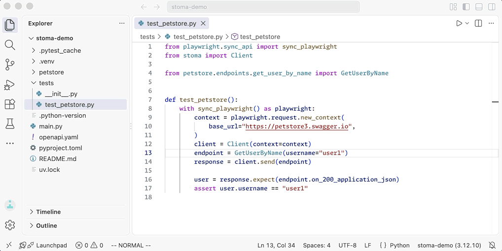

# Stoma

Stoma 是一个接口自动化和接口自动化测试工具，尝试实现「代码即协议」来解决如下问题：

* 代码中请求 HTTP 接口，IDE 不能自动联想接口参数，需要左边屏幕打开 IDE，右边屏幕在浏览器打开接口协议。
* 从响应中提取信息或者对响应断言时，同样需要左右对比查看结构。

现在 IDE 可以自动联想 Stoma 接口和响应。



Stoma 提供了 CLI 自动生成接口。


## 安装

需要 Python 3.12 或更高版本。

```bash
pip install stoma
```

Stoma 依赖 Playwright 的 Python 包，但**不需要浏览器二进制** —— 它只用 Playwright 的
`APIRequestContext` 发送请求，不启动浏览器，因此无需执行 `playwright install` 下载浏览器组件。

## 最小示例

定义接口、调用接口、对响应断言，三步完成。

```python
from pydantic import BaseModel
from stoma import APIRoute, APIRouter, ResponseSpec


class User(BaseModel):
    id: int
    name: str


router = APIRouter()


@router.get("/users/{user_id}")
class GetUserById(APIRoute):
    """按 ID 查询用户。"""

    user_id: int

    @property
    def on_200(self) -> ResponseSpec[User]:
        return ResponseSpec(
            status_code=200,
            media_type="application/json",
            expected_type=User,
        )
```

调用并断言：

```python
from playwright.sync_api import sync_playwright
from stoma import Client

with sync_playwright() as p:
    ctx = p.request.new_context(base_url="https://petstore3.swagger.io")
    client = Client(context=ctx)

    endpoint = GetUserById(user_id=1)
    response = client.send(endpoint)
    user = response.expect(endpoint.on_200)
    assert user.id == 1
    assert user.name == "alice"
```

接口定义与断言响应是同一套模型 —— `GetUserById` 用 `user_id: int` 声明请求参数，
用 `on_200` 声明响应协议，`response.expect()` 会校验 Status Code 与 Media type，
并把响应体转成 `User`。

## 指南

- [快速开始](https://github.com/dengmingcong/stoma/blob/master/docs/guide/quickstart.md) — 安装并以真实接口为例介绍用法。
- 定义接口 — Stoma 中一个接口由接口路由、接口参数和响应协议组成。
    * [接口路由](https://github.com/dengmingcong/stoma/blob/master/docs/guide/define-routes.md)
    * [接口参数](https://github.com/dengmingcong/stoma/blob/master/docs/guide/define-parameters.md)
    * [响应协议](https://github.com/dengmingcong/stoma/blob/master/docs/guide/define-response-specs.md)
- [接口请求和断言](https://github.com/dengmingcong/stoma/blob/master/docs/guide/client.md) — 使用 `Client` 调用接口，对接口响应断言。
- [生成接口](https://github.com/dengmingcong/stoma/blob/master/docs/guide/cli.md) — Stoma 提供了 CLI 命令基于 OpenAPI 协议自动生成接口。

## 实例

- [Petstore](./tests/examples/petstore/) — 演示如何使用 Stoma 定义并调用 Swagger 官方 [Petstore](https://petstore3.swagger.io/) 接口。

## 关于

[关于 Stoma](./docs/about.md) - 关于项目的说明。
