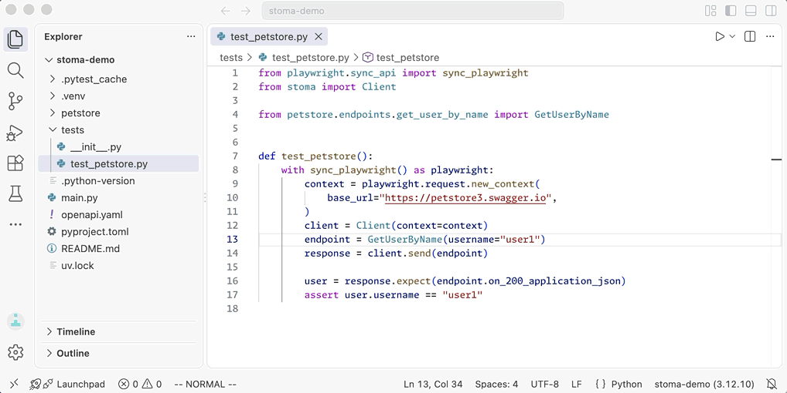

# Stoma

<p align="center">
  <a href="https://pypi.org/project/stoma/"></a>
  <a href="https://pypi.org/project/stoma/"></a>
  <a href="https://img.shields.io/pypi/dm/stoma.svg"></a>
  <a href="https://github.com/dengmingcong/stoma/blob/master/LICENSE"></a>
</p>

<p align="center"><b>Define with OpenAPI. Autocomplete with Stoma.</b></p>

<p align="center">
  
</p>

<!-- README-I18N:START -->

[English](./README.md) | **中文**

<!-- README-I18N:END -->

<p align="center">
  <a href="#安装">安装</a> ·
  <a href="#示例">示例</a> ·
  <a href="#关键特性">关键特性</a> ·
  <a href="#文档">文档</a> ·
  <a href="#关于">关于</a>
</p>

---

## 安装

需要 Python 3.12 或更高版本。

```bash
pip install stoma
```

## 示例

定义接口：

```python
from typing import Annotated
from pydantic import BaseModel, Field
from stoma import APIRoute, APIRouter, ResponseSpec

class User(BaseModel):
    id: Annotated[int | None, Field(examples=[10])] = None
    """Example: 10"""

    username: Annotated[str | None, Field(examples=["theUser"])] = None
    """Example: 'theUser'"""

    first_name: Annotated[str | None, Field(alias="firstName", examples=["John"])] = None
    """Example: 'John'"""

router = APIRouter(prefix="/api/v3")

@router.get("/user/{username}")
class GetUserByName(APIRoute):
    """按用户名查询用户。"""

    username: str

    @property
    def on_200(self) -> ResponseSpec[User]:
        return ResponseSpec(
            status_code=200,
            media_type="application/json",
            expected_type=User,
        )
```

调用接口：

```python
from playwright.sync_api import sync_playwright
from stoma import Client

with sync_playwright() as p:
    ctx = p.request.new_context(base_url="https://petstore3.swagger.io")
    client = Client(context=ctx)

    endpoint = GetUserByName(username="user1")
    response = client.send(endpoint)
    user = response.expect(endpoint.on_200)
    assert user.username == "user1"
```

## 关键特性

- 代码即协议：Stoma 保存接口调用所需的所有信息，调用接口时再也不用在 IDE 和接口文档之间切换。
- 自动联想： 感谢 Pydantic 和范型特性，IDE 可以自动补全请求和响应参数。
- OpenAPI CLI：提供 CLI 基于 OpenAPI 规范文档生成全部接口代码。
  


## 文档

- [快速开始](https://github.com/dengmingcong/stoma/blob/master/docs/guide/quickstart.zh.md) — 安装并以真实接口为例介绍用法。
- 定义接口 — Stoma 中一个接口由接口路由、接口参数和响应协议组成。
    * [接口路由](https://github.com/dengmingcong/stoma/blob/master/docs/guide/define-routes.zh.md)
    * [接口参数](https://github.com/dengmingcong/stoma/blob/master/docs/guide/define-parameters.zh.md)
    * [响应协议](https://github.com/dengmingcong/stoma/blob/master/docs/guide/define-response-specs.zh.md)
- [接口请求和断言](https://github.com/dengmingcong/stoma/blob/master/docs/guide/client.zh.md) — 使用 `Client` 调用接口，对接口响应断言。
- [生成接口](https://github.com/dengmingcong/stoma/blob/master/docs/guide/cli.zh.md) — Stoma 提供了 CLI 命令基于 OpenAPI 协议自动生成接口。

也可以看看演示仓库 [stoma-demo](https://github.com/dengmingcong/stoma-demo)，演示在实际项目中如何使用 Stoma。


## 关于

[关于 Stoma](https://github.com/dengmingcong/stoma/blob/master/docs/about.zh.md) — 项目由来、灵感与依赖。
