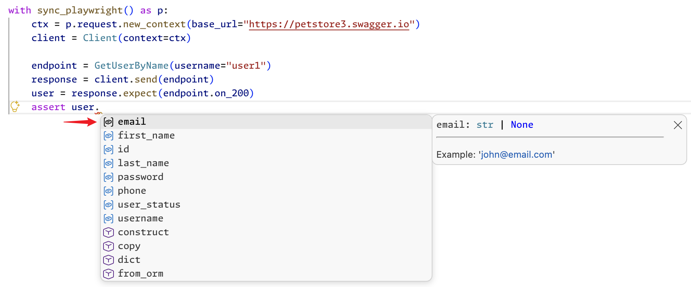

# Client

Endpoints defined in Stoma only hold data; calling them is done with `stoma.Client`.

## Calling an endpoint

Stoma implements endpoint calls on top of Playwright's [APIRequestContext](https://playwright.dev/python/docs/api/class-apirequestcontext). Stoma does not modify `APIRequestContext` in any way, so every feature works as usual.

`Client` does not create the `APIRequestContext` itself. You create it and pass it in, which keeps the lifetime of the context under your control; Stoma collects the endpoint's data and hands it to the `APIRequestContext`.

Take calling the endpoint `GetUserByName` as the example.

```python
from playwright.sync_api import sync_playwright
from stoma import Client

with sync_playwright() as p:
    ctx = p.request.new_context(base_url="https://petstore3.swagger.io")
    client = Client(context=ctx)

    endpoint = GetUserByName(username="user1")
    response = client.send(endpoint)
    user = response.expect(endpoint.on_200)
    assert user.username == "user1"
```

What happens:

1. Create a `Client` instance, passing in the `APIRequestContext` you created beforehand.
2. Create the endpoint instance, giving the endpoint's parameters their values.
3. Call `Client.send()`, passing in the endpoint instance.

### Response

`Client.send()` always returns a [stoma.Response](../../src/stoma/dependencies/response.py) instance.

A `Response` instance has a single attribute, `raw`, which holds the return value of the `APIRequestContext` request call — that is, a `playwright.sync_api.APIResponse`.

### Assertions

The `expect()` method of a `Response` takes a [response spec](./define-response-specs.md) instance. You can create one on the fly, or use one already bound to the endpoint — the example above uses the spec bound to the property `on_200`.

* If you pass a general response spec `ResponseSpec`, Stoma validates the response's `status_code` and `media_type`, and uses `expected_type` with `pydantic.TypeAdapter` to validate the body and return the corresponding object — `response.expect(endpoint.on_200)` returns a `User` object.
* If you pass an empty response spec `EmptyResponseSpec`, Stoma validates only the response's `status_code` and returns nothing.

Thanks to generics, the IDE infers the return type of `expect()`, and dot-completion lists the attributes of that type.



## Global headers

When you [create a Playwright APIRequestContext](https://playwright.dev/python/docs/api/class-apirequest), you can pass global headers to control the behavior of every request — for example, an auth token:

```python
ctx = p.request.new_context(
    base_url="https://api.example.com",
    extra_http_headers={"Authorization": "Bearer eyJhbGc..."},
)
client = Client(context=ctx)
```

`extra_http_headers` is sent with every request.
