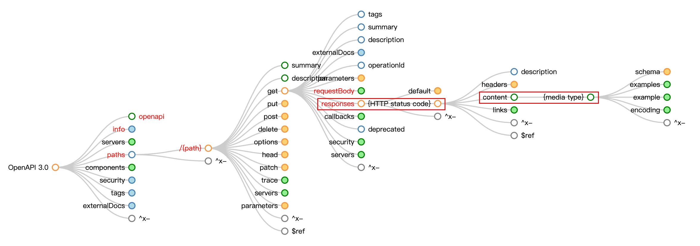

# Response specs

<!-- README-I18N:START -->

**English** | [中文](./define-response-specs.zh.md)

<!-- README-I18N:END -->
As [OpenAPI Map](https://openapi-map.apihandyman.io/?version=3.0) shows, the response of an HTTP endpoint can contain multiple status codes, and the content of each status code can contain multiple media types.



Stoma calls one media type under one status code a **response spec**, and uses it to define the data type of the corresponding content.

## Example

Take the Swagger Petstore endpoint [getUserByName](https://petstore.swagger.io/#/user/getUserByName) as the example. The OpenAPI spec looks like this:

```json
{
  "/user/{username}": {
    "get": {
      "summary": "Get user by user name.",
      "description": "Get user detail based on username.",
      "operationId": "getUserByName",
      "responses": {
        "200": {
          "description": "successful operation",
          "content": {
            "application/json": {
              "schema": {
                "$ref": "#/components/schemas/User"
              }
            },
            "application/xml": {
              "schema": {
                "$ref": "#/components/schemas/User"
              }
            }
          }
        },
        "400": {
          "description": "Invalid username supplied"
        },
        "404": {
          "description": "User not found"
        },
        "default": {
          "description": "Unexpected error"
        }
      }
    }
  }
}
```

You can see that:

* `responses` has several status codes.
* For status code 200 there may be two media types, but the data type is `User` in both cases.

In Stoma, the corresponding response specs are:

```python
@router.get("/user/{username}")
class GetUserByName(APIRoute):
    """Get user by user name.。

    Get user detail based on username.
    """

    username: str
    """The name that needs to be fetched. Use user1 for testing"""

    @property
    def on_200_application_json(self) -> ResponseSpec[User]:
        return ResponseSpec(
            status_code=200,
            media_type="application/json",
            expected_type=User,
        )

    @property
    def on_200_application_xml(self) -> ResponseSpec[User]:
        return ResponseSpec(
            status_code=200,
            media_type="application/xml",
            expected_type=User,
        )

    @property
    def on_400(self) -> EmptyResponseSpec:
        return EmptyResponseSpec(
            status_code=400,
        )

    @property
    def on_404(self) -> EmptyResponseSpec:
        return EmptyResponseSpec(
            status_code=404,
        )

    @property
    def on_default(self) -> EmptyResponseSpec:
        return EmptyResponseSpec(
            status_code=lambda c: c not in [200, 400, 404],
        )
```

Stoma binds response specs as `@property`. The name is not constrained — it only has to be distinguishable. There are two types, `ResponseSpec` and `EmptyResponseSpec`.

## ResponseSpec

`ResponseSpec` is the general response spec. It specifies `status_code`, `media_type` and `expected_type`, and it is generic — the generic parameter matches `expected_type`.

## EmptyResponseSpec

`EmptyResponseSpec` is the empty response spec. It means the response body is empty, and it covers these OpenAPI cases:

* the status code has no matching content.
* the status code has matching content but no media type is defined.
* a media type is defined but no schema is defined.
