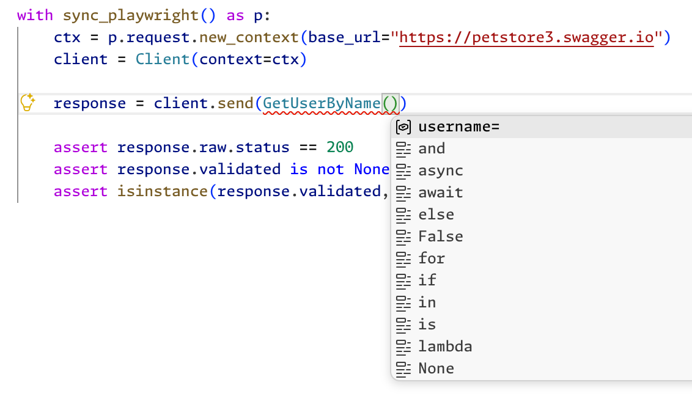
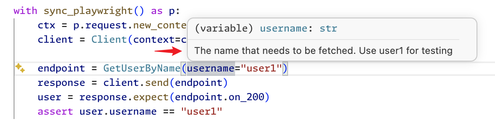
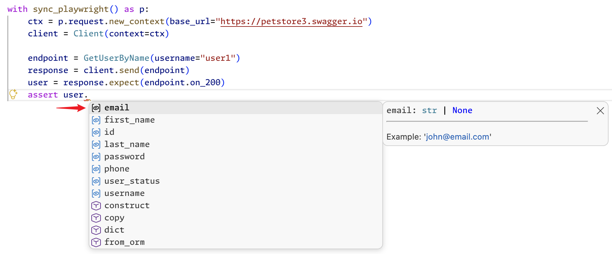

# Quickstart

## Installation

Requires Python 3.12 or higher.

```bash
pip install stoma
```

## Defining an endpoint

Take the Swagger Petstore endpoint [getUserByName](https://petstore3.swagger.io/#/user/getUserByName) as the example, and see how an endpoint is defined in Stoma.

```python
from typing import Annotated
from pydantic import BaseModel, Field
from stoma import APIRoute, APIRouter, ResponseSpec

class User(BaseModel):
    id: Annotated[int | None, Field(examples=[10])] = None
    """Example: 10"""
    username: Annotated[str | None, Field(examples=["theUser"])] = None
    """Example: 'theUser'"""
    first_name: Annotated[str | None, Field(alias="firstName", examples=["John"])] = None
    """Example: 'John'"""
    last_name: Annotated[str | None, Field(alias="lastName", examples=["James"])] = None
    """Example: 'James'"""
    email: Annotated[str | None, Field(examples=["john@email.com"])] = None
    """Example: 'john@email.com'"""
    password: Annotated[str | None, Field(examples=["12345"])] = None
    """Example: '12345'"""
    phone: Annotated[str | None, Field(examples=["12345"])] = None
    """Example: '12345'"""
    user_status: Annotated[int | None, Field(alias="userStatus", examples=[1])] = None
    """
    User Status

    Example: 1
    """

router = APIRouter(prefix="/api/v3")

@router.get("/user/{username}")
class GetUserByName(APIRoute):
    """Get user by user name.。

    Get user detail based on username.
    """

    username: str
    """The name that needs to be fetched. Use user1 for testing"""

    @property
    def on_200(self) -> ResponseSpec[User]:
        return ResponseSpec(
            status_code=200,
            media_type="application/json",
            expected_type=User,
        )
```

* `router = APIRouter(prefix="/api/v3")` — instantiates an `APIRouter` and sets the shared path prefix `/api/v3` for every endpoint registered on it.
* `@router.get("/user/{username}")` — defines the HTTP method (`GET`) and the path (`/user/{username}`) of the endpoint, which contains one path parameter, `username`. The resulting path is `/api/v3/user/{username}`.
* `class GetUserByName(APIRoute):` — defines the endpoint. Every endpoint in Stoma must be a subclass of `APIRoute`. `APIRoute` is itself a subclass of Pydantic's `BaseModel`, so defining an endpoint in Stoma and defining a Pydantic model use the same syntax.
    -  `username: str` — a path parameter. When the field name matches the path parameter, it is recognized as a path parameter.
    - property `on_200` — declares the response spec for status code 200.

## Calling an endpoint

```python
from playwright.sync_api import sync_playwright
from stoma import Client

with sync_playwright() as p:
    ctx = p.request.new_context(base_url="https://petstore3.swagger.io")
    client = Client(context=ctx)

    endpoint = GetUserByName(username="user1")
    response = client.send(endpoint)
    user = response.expect(endpoint.on_200)
    assert user.username == "user1"
```

* Stoma sends requests through Playwright's [APIRequestContext](https://playwright.dev/python/docs/api/class-apirequestcontext) and manages cookies and the rest; every Playwright feature works as usual.
* Stoma defines every endpoint as a Pydantic model, so the IDE autocompletes all parameters.
    
    Hovering a parameter also shows its description.
    
* `Client.send()` returns a `Response` instance. The `expect()` method of a `Response` takes a response spec, validates the status code and media type against it, and converts the body into the model the spec names using `pydantic.TypeAdapter` — generics make the IDE infer the return type.
    

## Recap

That covers the whole path from installation to a first runnable script. The core of Stoma comes down to three steps:

1. Define the endpoint with `APIRoute`, declaring its parameters and response types.
2. Organize the routes with `APIRouter`.
3. Send the request with `Client`.
