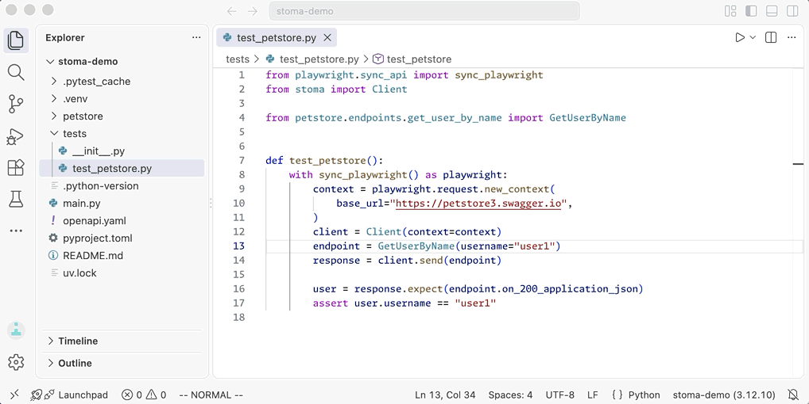
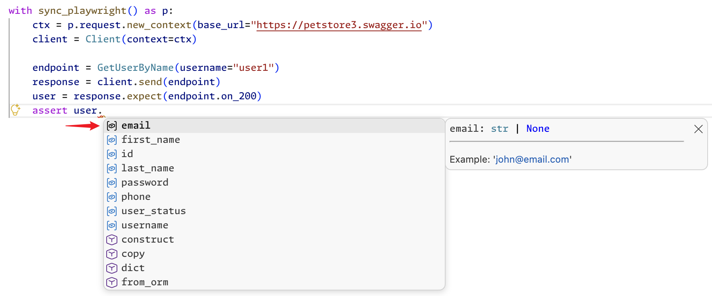

# OpenAPI 不该止步于接口文档：让 IDE 自动补全请求与响应

> 我是 Stoma 的作者。这篇文章回答两个问题：接口定义已经有 OpenAPI 了，为什么接口测试代码还需要手工维护请求参数、响应模型和类型；Python 如何根据 HTTP 状态码推导不同的响应类型。

---

## 问题

维护一套接口自动化测试，最花时间的不是写请求，是让模型和接口协议保持一致。

一个接口有三样东西需要对得上：请求参数在哪、响应长什么样、什么状态码算成功。这三样都写在 OpenAPI 协议里，但测试代码里要重新抄一遍。

抄的时候人是没有耐心的。少抄一个字段，接口返回 200，用例照样通过，断言形同虚设。协议新增了必填字段，模型里还是可选的，多出来的数据被静默丢掉。

更麻烦的是 IDE 对接口一无所知。参数名写错不会有红线，字段名拼错要等到断言失败才知道。

根源在于：**模型的来源是人，不是协议**。

## 协议本身是唯一来源

Stoma 的思路和 fastapi 相反。fastapi 是通过 Pydantic 模型生成 OpenAPI 描述的接口协议，Stoma 则是从 OpenAPI 生成 Pydantic 模型。

已经有 OpenAPI 协议的话，用 CLI 命令生成接口代码：

```bash
stoma spec.json --out app --prefix /api/v3
```

生成的接口定义，请求参数和响应协议都是带类型的类属性：

```python
@router.get("/user/{username}")
class GetUserByName(APIRoute):
    """按用户名查询用户。"""

    username: str

    @property
    def on_200_application_json(self) -> ResponseSpec[User]:
        return ResponseSpec(
            status_code=200,
            media_type="application/json",
            expected_type=User,
        )
```

因为接口是 Pydantic 模型，IDE 可以自动联想所有参数。



## 按状态码推导响应类型

OpenAPI 协议中，一个接口可以包含多个 status code，每个 status code 的 content 又可以包含多个 Media type。

Stoma 将一个 status code 下的一个 Media type 称为响应协议。生成时，它们被拆成每个响应协议一个 property：

```python
@router.get("/user/{username}")
class GetUserByName(APIRoute):
    """按用户名查询用户。"""

    username: str

    @property
    def on_200_application_json(self) -> ResponseSpec[User]:
        return ResponseSpec(
            status_code=200,
            media_type="application/json",
            expected_type=User,
        )

    @property
    def on_400(self) -> EmptyResponseSpec:
        return EmptyResponseSpec(
            status_code=400,
        )

    @property
    def on_404(self) -> EmptyResponseSpec:
        return EmptyResponseSpec(
            status_code=404,
        )

    @property
    def on_default(self) -> EmptyResponseSpec:
        return EmptyResponseSpec(
            status_code=lambda c: c not in [200, 400, 404],
        )
```

`ResponseSpec` 称为通用响应协议，规定了 `status_code`、`media_type` 和 `expected_type`，并且 `ResponseSpec` 是泛型，泛型参数和 `expected_type` 一致。

`EmptyResponseSpec` 称为空响应协议，表示响应的 body 是空的，只需要校验 `status_code`。

调用时，选定要断言的响应协议：

```python
from playwright.sync_api import sync_playwright
from stoma import Client

with sync_playwright() as p:
    ctx = p.request.new_context(base_url="https://petstore3.swagger.io")
    client = Client(context=ctx)

    endpoint = GetUserByName(username="user1")
    response = client.send(endpoint)
    user = response.expect(endpoint.on_200_application_json)
    assert user.username == "user1"
```

`Client.send()` 返回 `Response` 实例，`Response` 实例的 `expect()` 方法预期一个响应协议，会按照协议对 Status Code、Media type 校验，并使用 `pydantic.TypeAdapter` 将返回体转换为响应协议指定的模型。

得益于泛型特性，IDE 能自动推断 `expect()` 的返回值类型，可以使用点自动联想该类型的属性。



## 小结

请求参数是带类型的类属性，响应类型由响应协议指定，两边的来源都是 OpenAPI 协议，而不是手工抄写。IDE 因此能自动补全请求和响应参数。

## 安装

需要使用 Python 3.12 及以上版本。

```bash
pip install stoma
```

Stoma 内部基于 Playwright [APIRequestContext](https://playwright.dev/python/docs/api/class-apirequestcontext) 实现接口调用，不会对 `APIRequestContext` 做任何修改，所有特性都能正常使用。Stoma 只使用 `APIRequestContext`，从不启动浏览器，因此不需要安装浏览器二进制。

## 示例

演示仓库 [stoma-demo](https://github.com/dengmingcong/stoma-demo) 展示了在实际项目中如何使用 Stoma。

```bash
git clone https://github.com/dengmingcong/stoma-demo.git
cd stoma-demo
python -m venv .venv && source .venv/bin/activate
pip install -r requirements.txt
pytest
```

> ⚠️ 演示后端是 Swagger 官方 Petstore 公共服务，人人共享，可用性不保证，可能返回 HTTP 500。这是服务状态问题，与 Stoma 无关。

## 文档

- [快速开始](https://github.com/dengmingcong/stoma/blob/master/docs/guide/quickstart.md) — 安装并以真实接口为例介绍用法。
- 定义接口 — Stoma 中一个接口由接口路由、接口参数和响应协议组成。
    * [接口路由](https://github.com/dengmingcong/stoma/blob/master/docs/guide/define-routes.md)
    * [接口参数](https://github.com/dengmingcong/stoma/blob/master/docs/guide/define-parameters.md)
    * [响应协议](https://github.com/dengmingcong/stoma/blob/master/docs/guide/define-response-specs.md)
- [接口请求和断言](https://github.com/dengmingcong/stoma/blob/master/docs/guide/client.md) — 使用 `Client` 调用接口，对接口响应断言。
- [生成接口](https://github.com/dengmingcong/stoma/blob/master/docs/guide/cli.md) — Stoma 提供了 CLI 命令基于 OpenAPI 协议自动生成接口。

## 关于

我是 Stoma 的作者。Stoma 还在早期，API 和 CLI 都会调整。

比起 star，更想要的是反馈：生成的代码符合你的编码习惯吗？哪些接口形态还处理不了？文档里哪一段看不懂？

项目主页：https://github.com/dengmingcong/stoma

> 第一次听说 Stoma 是从哪里？欢迎在 Discussions 里说一声 —— 掘金、知乎、V2EX、开源中国、TesterHome、朋友推荐、搜索引擎，或者其他。
